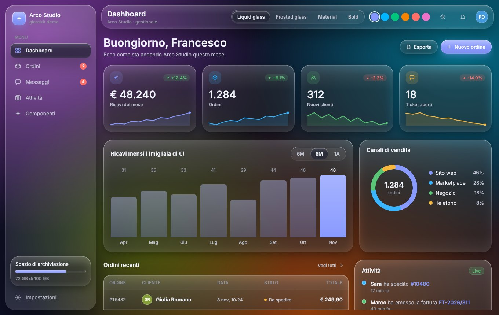
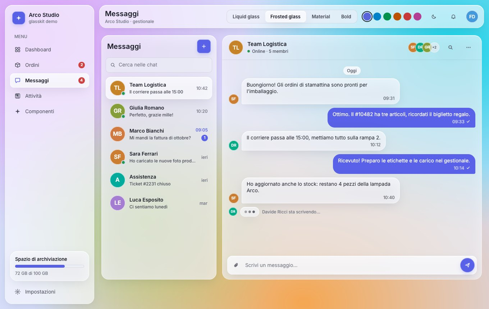
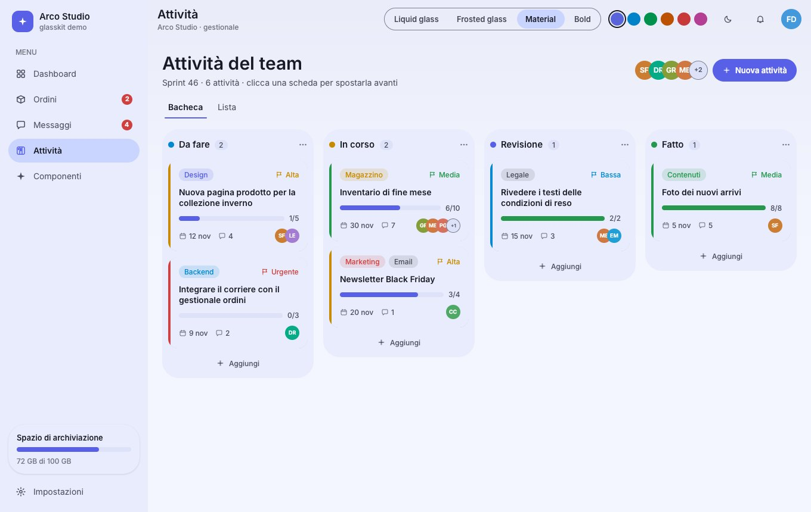
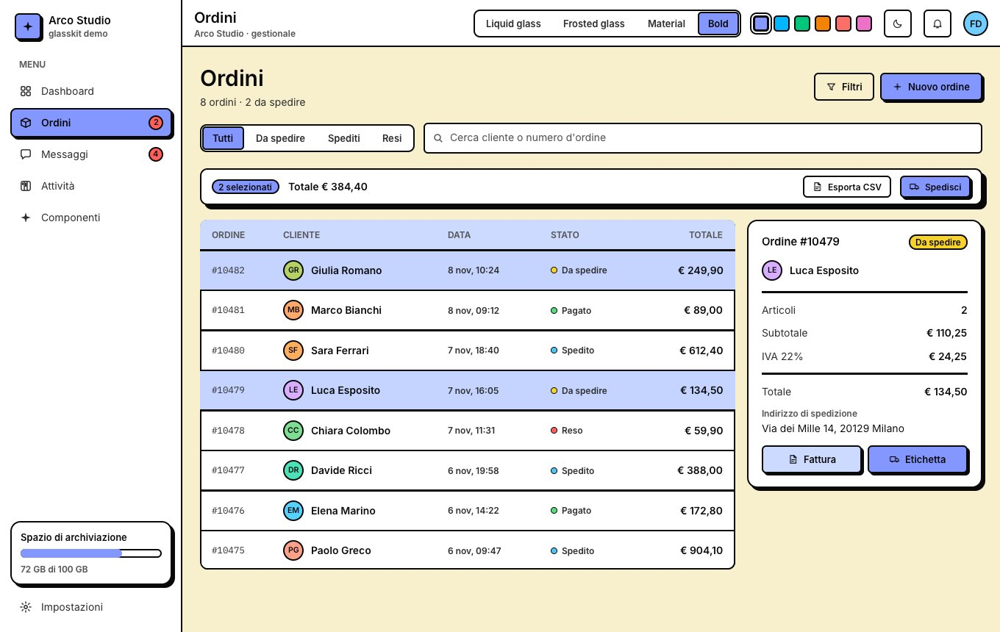
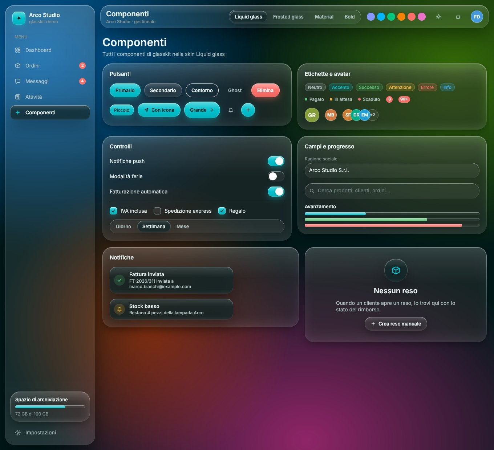
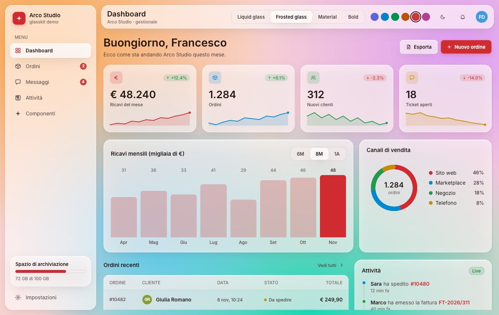
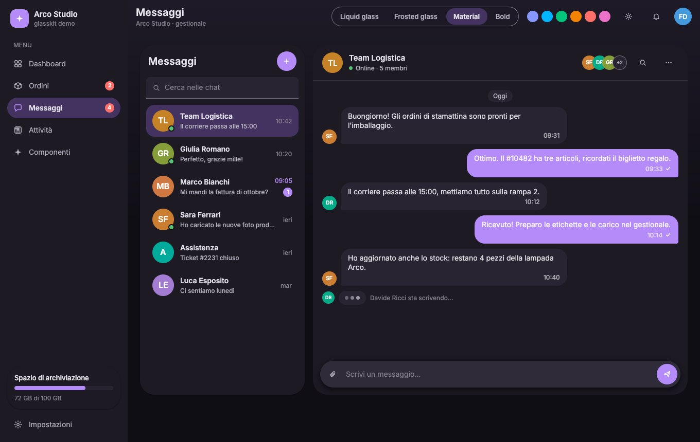

# glasskit

Componenti UI per [Rune](https://github.com/anomalyco/rune) (framework UI Rust renderizzato su GPU,
desktop e web) pensati per **gestionali, chat, dashboard e app per organizzare attività**.

Ogni componente legge un `Theme`, e un tema è una **skin** risolta per tema chiaro o scuro con un
colore d'accento a scelta:

| Skin | Linguaggio visivo |
| --- | --- |
| `Skin::Liquid` | Liquid glass: lastre trasparenti con bordo luminoso, riflesso speculare e profondità morbida |
| `Skin::Frost` | Frosted glass: pannelli lattiginosi fortemente sfocati, bordi sottili |
| `Skin::Material` | Material Design 3: superfici tonali piene, niente contorni, elevazione con ombre |
| `Skin::Bold` | Design moderno "bold": colori pieni, contorni spessi, ombre nette sfalsate |

La stessa interfaccia cambia skin, tema e accento al volo.



| | |
| --- | --- |
|  |  |
|  |  |
|  |  |

## Componenti

| Modulo | Componenti |
| --- | --- |
| `controls` | `Button` (5 tipi × 3 taglie, icone), `icon_button`, `chip`, `status`, `badge`, `avatar`, `avatar_stack`, `switch`, `checkbox`, `segmented`, `text_field`, `progress`, `field` |
| `data` | `stat_card` (KPI con variazione e sparkline), `sparkline`, `bar_chart`, `donut`, `table` (selezione righe, colonne flessibili), `timeline`, `meter` |
| `chat` | `conversation` (anteprima, non letti, presenza), `bubble`, `bubble_from`, `day_separator`, `typing`, `composer` |
| `tasks` | `task_card` (etichette, priorità, checklist, scadenza, assegnatari), `board_column` (kanban), `task_row` (to-do) |
| `layout` | `sidebar`, `nav_item`, `brand`, `page_header`, `section`, `tabs`, `toast`, `empty_state` |
| `surface` | `paint` (dipinge qualsiasi elemento come superficie della skin), `card`, `pane`, `divider`, `backdrop` |

## Uso

```toml
[dependencies]
rune = { git = "https://github.com/anomalyco/rune", rev = "39301f6793266450a057f270da06b048a689be96" }
glasskit = { git = "https://github.com/FrancescoDiBella/rune-glasskit" }
```

```rust
use glasskit::{Button, Kind, Skin, Theme, Tone, card, chip, icons};
use rune::{Cx, El, col};

fn view(s: &App, cx: &mut Cx<App>) -> El {
    let t = Theme::with_hue(Skin::Liquid, cx.system_dark(), 275.0);
    card(&t).padding(20.0).gap(12.0)
        .child(chip(&t, "Da spedire", Tone::Warning))
        .child(Button::new("Spedisci").icon(&icons::TRUCK).build(&t)
            .on_press(|s: &mut App| s.ship()))
}
```

I builder finiscono con `.build(&theme)` e restituiscono un normale `El` di Rune, quindi gli
handler si collegano come sempre (`.on_press`, `.key`, …). I componenti con stato interno
(`segmented`, `tabs`, `table`, `text_field`, `composer`) ricevono una closure sullo stato dell'app.

### Personalizzare

Tutti i campi di `Theme` sono pubblici: si parte da un preset e si cambia ciò che serve.

```rust
let mut t = Theme::with_hue(Skin::Bold, false, 340.0)   // tonalità d'accento OKLCH
    .with_accent(rune::oklch(0.75, 0.2, 140.0))          // o un colore preciso
    .with_roundness(0.5);                                // angoli più squadrati
t.stroke = 3.0;                                          // contorni ancora più spessi
t.c.page = rune::oklch(0.96, 0.03, 200.0);               // sfondo della pagina
t.ty.display.size = 34.0;                                // scala tipografica
```

### Vetro e sfocatura

Le skin di vetro rendono al meglio sopra `backdrop(&t)` o su contenuti colorati. `pane(&t)` e
`paint(.., blur: true)` applicano un vero `backdrop_blur`: Rune ne sfoca al massimo **quattro per
frame**, quindi riservalo ai pannelli grandi (sidebar, barra superiore). Le altre superfici
disegnano lo stesso tono, bordo luminoso e profondità senza sfocatura.

## Demo

`demo/` è un gestionale di esempio (dashboard, ordini, messaggi, bacheca attività, galleria
componenti) con selettore di skin, accento e tema chiaro/scuro. I dati sono inventati.

- **Web:** `docs/` contiene la build WebGPU; attivando GitHub Pages sulla cartella `docs/` è
  pubblicata su `https://francescodibella.github.io/rune-glasskit/`. Serve un browser con
  WebGPU (Chrome/Edge recenti, Safari 26+).
- **Desktop:** `cargo run --release -p glasskit-demo`
- **Headless:** `target/release/glasskit-demo --snap out.png --size 1360x860 -- bold dark tasks hue=60`
  (argomenti: `liquid|frost|material|bold`, `light|dark`, `orders|chat|tasks|gallery`, `hue=<0-360>`)

Nella demo: clic su una scheda della bacheca per spostarla alla colonna successiva, clic sulle
righe degli ordini per selezionarle (compare la barra azioni), invio messaggi dalla chat,
interruttori e checkbox nella galleria.

### Ricompilare la build web

Dal checkout di Rune alla revisione indicata (lo script è suo), con questo workspace accanto:

```sh
rustup target add wasm32-unknown-unknown
cargo install wasm-bindgen-cli --version 0.2.129 --locked
scripts/web-build.sh glasskit-demo --out docs
```

## Stato

Rune è pre-release e qui è fissato a una revisione del branch `dev`; anche glasskit è alla 0.1.
Licenza MIT.
